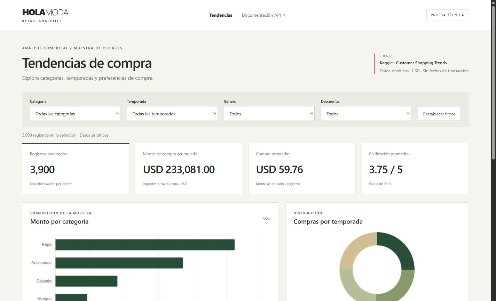
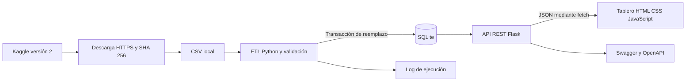

# Tendencias de compra para retail

Prueba técnica de Desarrollo e Integración para Hola Moda. La solución procesa una muestra sintética
de Kaggle, la valida y carga en SQLite. Una API REST en Flask entrega los datos a un tablero con filtros,
indicadores, gráficos y detalle paginado. Funciona localmente sin Docker ni servidor de base de datos.

## Instalación en Windows

Requisitos: Git y **Python 3.12** con pip. Verificar `git --version` y `py -3.12 --version`.
La primera preparación requiere internet para paquetes y dataset. Después, el tablero y Swagger funcionan sin conexión.

```powershell
git clone https://github.com/Rodolfo0608/HolaModa.git
cd HolaModa
py -3.12 -m venv .venv
.\.venv\Scripts\python.exe -m pip install -r requirements.txt
.\.venv\Scripts\python.exe scripts/download_data.py
.\.venv\Scripts\python.exe -m retail.etl
.\.venv\Scripts\python.exe -m pytest -q
.\.venv\Scripts\python.exe app.py
```

Abrir http://127.0.0.1:5000 y http://127.0.0.1:5000/docs. Detener el servidor con `Ctrl+C`.
No hace falta activar el entorno ni cambiar políticas de PowerShell.
Si se descarga el proyecto como ZIP, extraerlo y comenzar desde el comando de creación de `.venv`.
En Linux/macOS: usar `python3.12 -m venv .venv` y sustituir el ejecutable de Windows por `.venv/bin/python`.

## Opción con Docker

Se incluyen `Dockerfile` y `compose.yaml` como alternativa a la instalación de Python en el anfitrión.
Requiere Docker y Compose en ejecución. Consultar [preparación, traslado y comprobaciones](docs/DOCKER.md).
**La variante Docker está pendiente de construcción y prueba**, porque Docker no está instalado aquí.

```powershell
docker compose up --build -d
```

El tablero de esta modalidad utiliza http://127.0.0.1:5001. La construcción requiere internet;
después puede ejecutarse sin conexión con la imagen ya preparada.

## Resultados de referencia

Sin filtros: **3.900 registros**, **USD 233.081,00**, compra promedio **USD 59,76** y calificación **3,75 / 5**.
Ropa (`Clothing`) en invierno (`Winter`): **448 registros** y **USD 27.274,00**.
Las cifras describen la muestra sintética. No son ventas ni clientes de Hola Moda.



## Arquitectura



El ETL se ejecuta por consola. La API consulta SQLite y sirve el frontend.
La interfaz obtiene cifras y gráficos mediante `fetch`; no lee directamente el CSV ni la base.
Todo comparte origen y no necesita CORS para esta demostración.

## Estructura

```text
app.py                    Aplicación Flask y endpoints
retail/db.py              Conexión y esquema SQLite
retail/etl.py             Validación, transformación y carga
retail/openapi.py         Contrato OpenAPI
scripts/download_data.py  Descarga y verificación de la fuente
templates/                Páginas HTML
static/                   CSS, JavaScript y bibliotecas locales
data/source.json          Autor, versión y SHA-256 de la fuente
tests/                    Pruebas con datos controlados
docs/                     Documento técnico y material de sustentación
instance/                 Base generada, excluida de Git
```

## Proceso ETL

1. Leer UTF-8 y comprobar las 19 columnas utilizadas.
2. Convertir enteros y calificaciones, limpiar espacios exteriores y convertir Yes/No a 1/0.
3. Convertir importes a centavos con `Decimal`. Validar valores finitos, rangos y precisión.
4. Comprobar identificadores positivos y únicos dentro del archivo.
5. Rechazar el lote completo ante una fila inválida, indicando su línea y motivo.
6. Reemplazar la instantánea en una transacción y registrar la carga confirmada.

Una recarga no acumula duplicados. El historial crece deliberadamente por cada ejecución satisfactoria.
La política de rechazo evita publicar cifras parciales sin advertencia. Un fallo de escritura revierte
la transacción. No ejecutar varias instancias del ETL simultáneamente.

```powershell
# Repetir la carga
.\.venv\Scripts\python.exe -m retail.etl
# Usar otra base para experimentar
.\.venv\Scripts\python.exe -m retail.etl --file ruta\archivo.csv --db instance\prueba.db
```

## API

| Ruta GET | Función |
|---|---|
| `/api/health` | Disponibilidad y cantidad de filas |
| `/api/filters` | Categorías, temporadas y géneros disponibles |
| `/api/summary` | Cantidad, monto, promedio y calificación |
| `/api/groups/{dimension}` | Agrupar por category, season, item o payment |
| `/api/purchases` | Detalle paginado, máximo 100 por página |
| `/api/pipeline` | Última carga, fecha UTC, SHA-256 y duración |
| `/api/openapi.json` | Especificación OpenAPI 3.0.3 |

Resumen, agrupación y detalle aceptan `category`, `season`, `gender` y `discounted`, combinados con AND.
`discounted` acepta `0` o `1`. Los demás valores se consultan en `/api/filters`.
La API conserva los valores originales en inglés y la interfaz traduce las etiquetas principales.
Ejemplo: http://127.0.0.1:5000/api/summary?category=Clothing&season=Winter

Sin coincidencias se devuelven cantidad y monto cero con promedios `null`. Parámetros inválidos: 400.
Base no disponible: 503. Rutas inexistentes: 404. Operaciones no permitidas: 405.
Swagger permite consultar el esquema y ejecutar ejemplos reales desde el navegador.

## Decisiones técnicas

| Decisión | Motivo y límite |
|---|---|
| Flask | Tecnología conocida y suficiente para rutas, consultas y presentación |
| SQLite | Instalación sencilla para una muestra pequeña; PostgreSQL permitiría mayor concurrencia |
| csv y Decimal | Transformación explícita sin añadir pandas para 3.900 registros |
| JavaScript y CSS propios | Consumo directo de la API sin proceso de compilación |
| Chart.js y Swagger locales | Demostración sin depender de CDN |
| Carga completa | Consistencia de una fuente estática; no es una integración incremental de POS |
| Docker opcional | Empaquetado preparado con Waitress; construcción y ejecución pendientes de prueba |

## Calidad y seguridad

Las pruebas verifican cálculos, filtros, paginación, SQL parametrizado, rechazo de datos inválidos y recargas.
GitHub Actions ejecuta los tests sin Kaggle, usando una muestra controlada. Consultar su resultado en Actions
después de publicar: la ejecución local no garantiza que la ejecución remota haya finalizado.

Los valores de consulta se parametrizan y las columnas se seleccionan de listas permitidas.
El frontend inserta datos con `textContent` y maneja errores de consulta. Los detalles de errores internos
quedan en el servidor. Se incorporan cabeceras CSP, `nosniff` y protección contra enmarcado.
El servidor escucha en `127.0.0.1`, con debug desactivado. Esta es una demo local sin autenticación.
Para operación pública se requerirían HTTPS, servidor WSGI, controles de acceso y límites de solicitudes.

## Documentación

- [Documento técnico](docs/TECNICO.md)
- [Guía paso a paso](docs/GUIA_PASO_A_PASO.md)
- [Sustentación y demostración](docs/SUSTENTACION.md)
- [Presentación PowerPoint de ocho diapositivas](docs/Sustentacion_HolaModa.pptx)
- [Origen y límites de los datos](data/README.md)
- [Bibliotecas locales](static/vendor/README.md)

## Mejoras futuras

PostgreSQL y migraciones de esquema; entidades cliente/ticket/detalle para fuentes reales; carga incremental;
ejecuciones programadas y alertas; roles de acceso; pruebas automatizadas de interfaz y contenedores comprobados.
Para millones de filas se necesitarían procesamiento por lotes, staging y publicación atómica de versiones.

## Solución de problemas

- Python no disponible: instalar Python 3.12 y abrir otra terminal. Comprobar `py -3.12 --version`.
- ModuleNotFoundError: usar el ejecutable de `.venv` e instalar `requirements.txt`.
- Puerto 5000 ocupado: detener otra instancia o usar `.\.venv\Scripts\python.exe -m flask --app app:create_app run --port 5001`.
- API devuelve 503: ejecutar el ETL y comprobar `instance/retail.db`.
- Descarga bloqueada: consultar el procedimiento manual en `data/README.md`.
- Cambios no visibles: reiniciar Flask y recargar el navegador.
