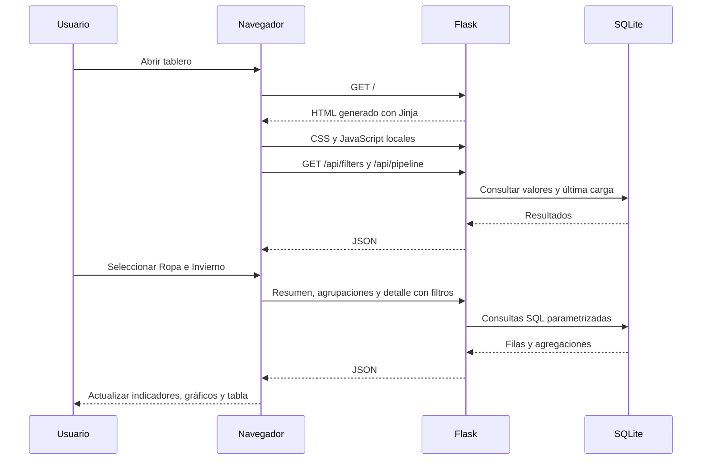

# Frontend del tablero de tendencias de compra

## Qué se construyó

Una página web de consulta con cuatro filtros compartidos, cuatro indicadores, tres gráficos,
detalle paginado y estado de la última carga. La página es servida por Flask, mientras que JavaScript
ejecutado en el navegador consulta la API y actualiza los datos sin recargar toda la página.

No se construyó el frontend en Python dentro del navegador. Python y Flask trabajan en el servidor.
La parte visible utiliza HTML, CSS y JavaScript. Jinja genera las referencias a archivos al servir el HTML.

## Herramientas utilizadas realmente

| Herramienta | Función | Dónde se utiliza |
|---|---|---|
| HTML5 | Estructura, formularios, tablas, áreas de contenido y elementos semánticos | `templates/index.html` |
| Jinja2 3.1.6 | Plantilla del servidor; `url_for` genera rutas a CSS y JavaScript | `templates/index.html` y `templates/docs.html` |
| CSS propio | Colores, tipografía del sistema, distribución con Grid/Flexbox y adaptación de pantalla | `static/app.css` |
| JavaScript nativo | Eventos, filtros, peticiones HTTP, actualización del DOM y paginación | `static/app.js` |
| fetch y async/await | Obtener JSON desde la API Flask | Función `api` |
| FormData y URLSearchParams | Convertir los filtros del formulario en parámetros de consulta | Función `refresh` |
| Promise.all | Solicitar en paralelo resumen, agrupaciones y detalle | Función `refresh` |
| AbortController y contador de generación | Cancelar consultas anteriores y evitar aplicar respuestas atrasadas | Función `refresh` |
| Intl.NumberFormat | Formatear conteos e importes USD según es-PA | Inicio de `static/app.js` |
| Chart.js 4.4.8 | Barras horizontales y gráfico de dona dibujados en canvas | `static/vendor/chart.umd.js` |
| Swagger UI 5.17.14 | Interfaz separada para explorar y ejecutar consultas de la API | `/docs`, `static/docs.js` y `static/vendor/` |
| Flask 3.1.2 | Servir HTML, archivos estáticos y respuestas JSON | `app.py`, en el servidor |

La implementación final usa CSS propio y bibliotecas locales. Bootstrap, React, jQuery y Node/npm
no son dependencias del tablero. Se eligió una interfaz sencilla sin un paso adicional de compilación.
Pandas tampoco es dependencia del ETL: se utilizan `csv`, `Decimal` y SQLite para las transformaciones de esta muestra.

## Archivos y responsabilidades

`templates/index.html` define los espacios del tablero y carga los scripts con `defer`.
Eso permite que el HTML se haya interpretado cuando el código JavaScript busca sus elementos.
Los valores numéricos iniciales son marcadores; no se incluyen cifras de negocio fijas en el HTML.

`static/app.css` establece el diseño. Grid distribuye indicadores y gráficos; Flexbox organiza navegación
y filtros. Las reglas de 900 y 550 píxeles reorganizan el contenido para pantallas más estrechas.
La tabla de detalle permite desplazamiento horizontal cuando no cabe en el ancho disponible.

`static/app.js` concentra la lógica del tablero. No guarda credenciales, no ejecuta SQL y no abre SQLite.
Los archivos de `static/vendor` pertenecen a las bibliotecas de terceros y conservan sus licencias.

`templates/docs.html` y `static/docs.js` cargan Swagger UI con la especificación `/api/openapi.json`.
Swagger es documentación interactiva de la API, no un framework del tablero ni el motor de la base.

## Recorrido de una consulta

La URL del navegador puede seguir siendo `/` mientras los filtros se envían en peticiones de fondo.
En esta versión no se guardan filtros en la URL ni en almacenamiento del navegador.
Recargar la página restablece la selección.

## Funciones principales de JavaScript

| Función | Responsabilidad |
|---|---|
| `api` | Ejecutar fetch, interpretar JSON y convertir respuestas HTTP de error en un mensaje |
| `initialize` | Cargar opciones de filtros, mostrar última carga y solicitar los datos iniciales |
| `refresh` | Cancelar consultas anteriores, leer filtros, pedir datos y actualizar el tablero |
| `renderChart` | Liberar el gráfico anterior, crear el nuevo y generar su tabla de valores |
| `renderTable` | Dibujar detalle, estado vacío y controles de paginación |
| `label` | Traducir categorías, temporadas y géneros sin alterar los valores originales de la API |

Los eventos del formulario y de los botones llaman a estas funciones.
Cambiar un filtro vuelve a la página 1. Restablecer filtros también vuelve a la página 1.
La tabla solicita diez registros por página; no descarga todas las filas para mostrarlas de una vez.

## Correspondencia entre pantalla y API

| Elemento visible | Endpoint y valor |
|---|---|
| Opciones de categoría, temporada y género | `/api/filters` |
| Registros analizados | `/api/summary`, `records` |
| Monto acumulado | `/api/summary`, `total_amount_usd` |
| Compra promedio | `/api/summary`, `average_amount_usd` |
| Calificación promedio | `/api/summary`, `average_rating` |
| Barras por categoría | `/api/groups/category`, `amount_usd` |
| Dona por temporada | `/api/groups/season`, `records` |
| Top 10 de productos | `/api/groups/item`, primeros diez por monto descendente |
| Detalle paginado | `/api/purchases`, `data`, `total`, `pages` |
| Estado del pipeline | `/api/pipeline`, fecha, filas y SHA-256 de última carga |

La traducción visual «Ropa» envía `category=Clothing`; «Invierno» envía `season=Winter`.
Los cuatro filtros se combinan con AND. El dropdown de descuento utiliza `1`, `0` o vacío.
Los nombres de productos permanecen en el idioma del dataset. Las temporadas representan la fuente,
no temporadas comerciales definidas para Panamá.

## Buenas prácticas presentes y sus límites

Los valores procedentes de datos se insertan con `textContent`, evitando interpretarlos como HTML.
Los errores son visibles y el botón Reintentar permite repetir la consulta. Durante la carga se muestra un estado
y se utiliza `aria-busy`. Si falla una actualización, se advierte que las cifras anteriores pueden estar desactualizadas.

Cada gráfico tiene una descripción y una tabla desplegable con sus valores. El formulario tiene etiquetas,
los encabezados del detalle identifican sus columnas y hay indicadores de foco para navegar con teclado.
Eso aporta accesibilidad, pero no constituye una certificación WCAG ni una prueba exhaustiva con lectores de pantalla.

Las bibliotecas locales eliminan la dependencia de una CDN durante la demostración.
El documento no utiliza fuentes remotas. El enlace de atribución a Kaggle requiere internet si se abre.
El navegador y la API comparten origen, por lo que esta instalación no necesita CORS adicional.

No hay suite automatizada de navegador, compilación de frontend, login, guardado de preferencias ni exportación Excel.
No los exige la prueba. La interfaz se ha revisado manualmente en el navegador; los tests automatizados cubren
transformaciones, consultas y disponibilidad de recursos, no todos los gestos de la interfaz.

## Cómo demostrar que consume la API

1. Abrir el tablero y las herramientas de desarrollo del navegador con F12.
2. Entrar en Network o Red y filtrar por Fetch/XHR.
3. Cambiar categoría a Ropa y temporada a Invierno.
4. Mostrar la petición `/api/summary?category=Clothing&season=Winter...`.
5. Abrir su respuesta: 448 registros, USD 27.274, promedio USD 60,88 y calificación 3,73.
6. Mostrar las peticiones a agrupaciones y detalle y cómo corresponden a los gráficos y la tabla.

También puede consultarse la misma selección desde Swagger. Esa coincidencia permite explicar la separación
entre obtener datos y presentarlos.

## Explicación breve para la sustentación

«El frontend está hecho en HTML, CSS propio y JavaScript. Flask entrega la plantilla y la API.
Cuando cambio un filtro, JavaScript envía consultas con fetch y recibe JSON. Chart.js dibuja las agrupaciones
y la tabla muestra el detalle paginado. La base se consulta en el servidor. Las bibliotecas son locales para
que la demostración funcione sin internet después de preparar los datos».

Referencia del patrón utilizado: https://flask.palletsprojects.com/en/stable/patterns/javascript/
