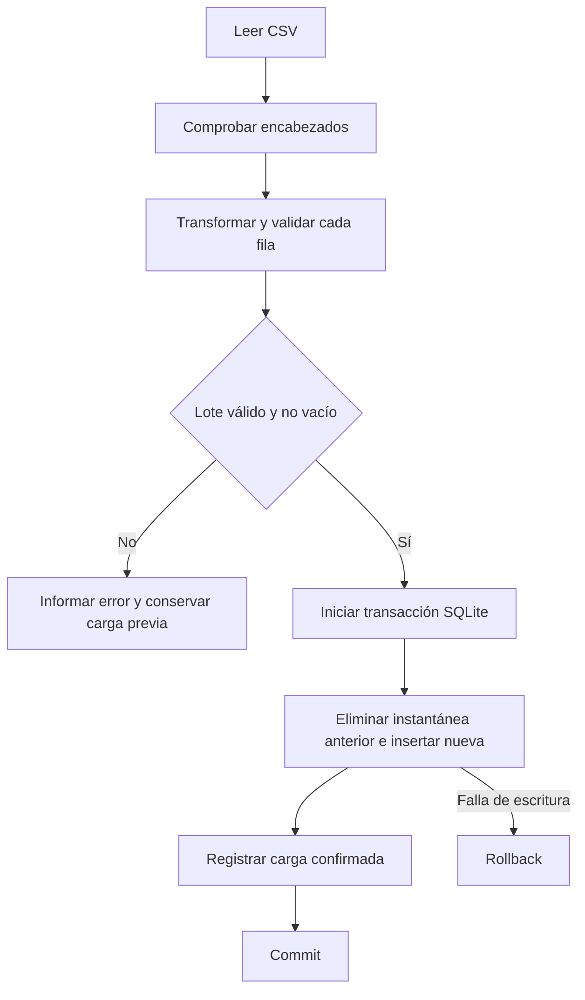

# Diseño técnico de la solución

## Propósito y alcance

La aplicación demuestra una integración de datos de principio a fin para explorar preferencias de compra.
Se eligió una fuente relacionada con retail para conectar el ejercicio con consultas comerciales habituales.
La información es sintética y no representa operaciones reales. La solución se ejecuta localmente.

## Responsabilidades

La descarga obtiene la versión 2 de Kaggle y comprueba una huella SHA-256 conocida. Esa huella verifica
que el contenido coincide con la versión revisada; no demuestra que los datos representen la realidad.

El ETL valida todas las filas antes de escribir. Rechaza un archivo vacío, columnas faltantes,
identificadores duplicados, importes negativos o no finitos, valores Yes/No desconocidos y campos obligatorios vacíos.
Almacena importes como enteros en centavos. Convierte calificaciones a número, limpia espacios y normaliza booleanos.
No modifica nombres propios ni categorías para evitar agrupar valores distintos mediante reglas no justificadas.

SQLite conserva la instantánea en `purchases` y registra ejecuciones satisfactorias en `etl_runs`.
La API implementa consultas de lectura, filtros combinados, agregaciones y paginación con orden estable por cliente.
El navegador utiliza `fetch` para solicitar JSON y Chart.js para dibujar los resultados.

## Modelo de datos

| Campo de destino | Origen o regla |
|---|---|
| customer_id | Customer ID, entero positivo, clave de la instantánea |
| age | Age, entero de 0 a 120 |
| gender, item, category | Gender, Item Purchased, Category, sin espacios exteriores |
| amount_cents | Purchase Amount (USD) multiplicado por 100 con Decimal |
| location, size, color, season | Location, Size, Color, Season |
| rating | Review Rating, número finito de 0 a 5 |
| subscribed, discounted, promo | Subscription Status, Discount Applied, Promo Code Used, Yes/No a 1/0 |
| payment, shipping | Payment Method, Shipping Type |
| previous_purchases | Previous Purchases, entero no negativo |
| preferred_payment, frequency | Preferred Payment Method, Frequency of Purchases |

El índice compuesto `(category, season)` apoya una combinación habitual de filtros.
Para 3.900 filas, también es razonable recorrer la tabla en algunas agrupaciones. No se afirma rendimiento
a gran escala sin mediciones con una carga representativa.

`etl_runs` conserva ID, fecha UTC, nombre del archivo, SHA-256, cantidad de filas y duración medida hasta el registro
de auditoría. La duración no incluye el arranque del intérprete ni garantiza medir el tiempo de commit completo.
Los intentos fallidos se informan por logging de consola y no se guardan como cargas exitosas.

## Consistencia de la carga

Se conserva todo el lote validado en memoria, decisión apropiada para este archivo pequeño.
La semántica es reemplazo completo de una instantánea, no un upsert de eventos históricos.
Reejecutar el mismo archivo mantiene los mismos registros y cifras, aunque añade una ejecución al historial.
La API usa una conexión corta por consulta. Si se recarga mientras el tablero realiza varias consultas,
podrían corresponder a versiones distintas. En esta demo se ejecuta el ETL antes de consultar el tablero.
Una evolución incluiría identificadores de versión compartidos por todos los endpoints.

## Métricas

- Registros: `COUNT(*)` sobre la selección.
- Clientes: `COUNT(DISTINCT customer_id)`. Coincide con registros por el grano de la fuente.
- Monto acumulado: suma de centavos dividida entre 100.
- Compra promedio: promedio de centavos dividido entre 100, redondeado a dos decimales para presentación.
- Calificación: promedio simple de las calificaciones observadas.
- Top 10: productos ordenados por monto descendente, con nombre ascendente para desempatar.

Una selección vacía presenta promedios nulos. No confundir falta de observaciones con una calificación cero.
El promedio utiliza redondeo de Python para visualización; el monto almacenado y las sumas se conservan en centavos.

## Controles y límites

Las consultas utilizan placeholders para los valores. Los nombres de columnas provienen de listas controladas.
Se rechazan parámetros desconocidos en consultas filtradas y paginación fuera de rango.
No hay endpoints de escritura, subida de archivos ni acceso remoto a SQL desde el navegador.

La interfaz cancela solicitudes anteriores cuando cambia la selección, evita inyectar datos como HTML
y ofrece tablas con los valores de cada gráfico. Un fallo de consulta muestra un mensaje y permite reintentar.
Los números previos se señalan como potencialmente desactualizados si una actualización falla.

El servidor Flask integrado es para la demostración local. Antes de desplegar públicamente se requiere
WSGI, HTTPS, autenticación, límites de solicitudes, gestión de secretos y revisión de dependencias.
La autorización de la API y la automatización del ETL quedan como ampliaciones de alcance.

## Validación

La suite usa muestras controladas y comprueba también rollback ante un fallo SQL posterior al borrado.
Se contrastaron con el CSV completo 3.900 observaciones y un monto acumulado de USD 233.081.
Se comprobaron filtros, paginación y una consulta real desde Swagger en el navegador.
El registro de comprobaciones está en `VALIDACION.md`.

## Alternativas evaluadas

PostgreSQL resulta más adecuado para múltiples escritores y una operación compartida, pero añade instalación
y administración. React puede ser útil para una interfaz compleja, pero este tablero no requiere otra cadena de compilación.
Pandas simplifica transformaciones tabulares extensas; aquí `csv`, `Decimal` y SQLite cubren el proceso de forma explícita.
Se añadió una alternativa Docker con Waitress, imagen sin privilegios de root y volumen de SQLite.
La construcción y ejecución de esa alternativa están pendientes de prueba. No es obligatoria en el enunciado.
Las instrucciones y limitaciones están en `DOCKER.md`.

## Evolución

Con una fuente ERP/POS real se separarían cliente, ticket y detalle, con claves de origen y fechas de evento.
El pipeline usaría staging, validación por lotes, trazabilidad de rechazos y publicación de versiones.
PostgreSQL, migraciones, orquestación, observabilidad y pruebas de carga se incorporarían según volumen y objetivos operativos.
